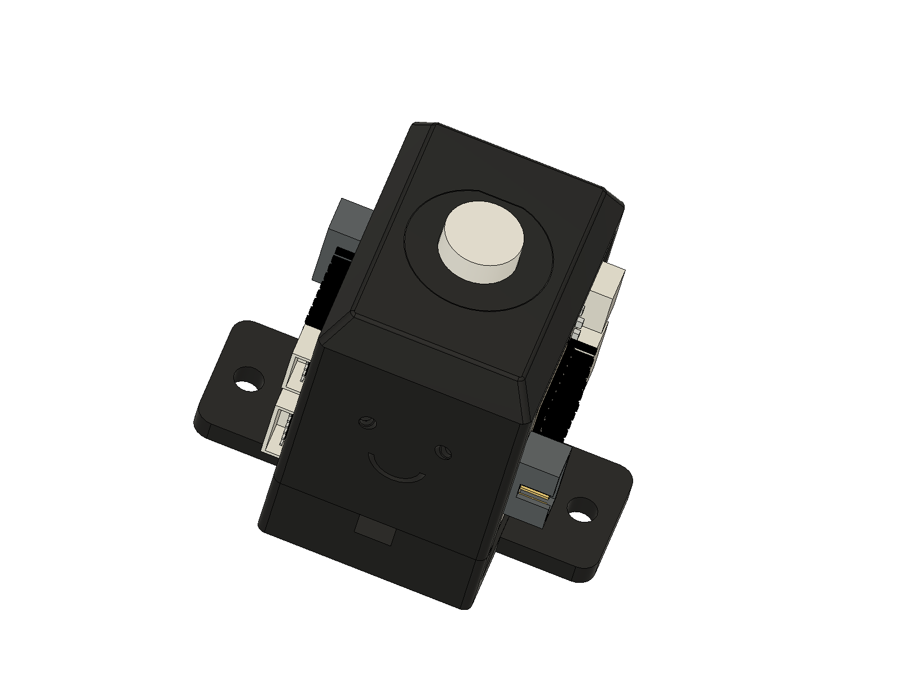

# Photoreactor Rev B housing (draft)

Draft release for sharing. Expect changes.

Part renders: `outputs/Rev-B/images/`.

- `outputs/Rev-B/step/` - STEP per part (and assembly)
- `outputs/Rev-B/stl/` - print files
- `outputs/Rev-B/BOM_Rev-B.csv` - per-reactor BOM
- `designs/` - Fusion archive (.f3z)

## Print
ABS/ASA or PLA, matte black for light-tightness. No supports.
Base flat side down, tower seam face down, insert upright.

## Assemble
1. Press heat-sets: 4x M3 into the board pockets (2 per side in base, 2 per side in tower), 4x M2 into the base fan pocket floor, 4x M2 into the tower cooling-fan pocket.
2. Glue two magnets to the stir-fan hub (balanced). Drop the fan into the base, leads out the centre groove on -Y, fix with 4x M2x10.
3. Seat the tower on the base rim.
4. Stick a thermal pad and heat sink to the back of each LED board. Screw both boards into the +/-X pockets with 4x M3x6 each. The boards clamp base and tower together.
5. Mount the cooling fan in the +Y pocket with 4x M2x10.
6. Push a PLP2-1200 into each eye on -Y until the flange seats.
7. Wire per `electrical/docs/wiring/`: controller to +X board J1; +X J2 to -X J1 (link runs in the channel under the cooling fan); fans to J3. Set JP_FANV to 5 V.
8. Drop in the 8 mL insert (flat to +Y), then the vial.
9. Bolt to the breadboard with 2x M6x10.

## Open items
Heat-sink retention clip, confirmed vial OD, cable tidying, real assembly joints.
